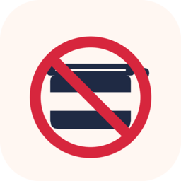

# Spam Reporter

An Android app that finds the spam texts you've received and files complaints with the
**FCC** (all unwanted texts) and the **FTC** (commercial/telemarketing texts), then gives you
a report of every ticket and report number.



## What it does

1. **Your info and attestation.** It collects the name, address, email, and phone number the agencies require.
   It also shows the FCC's penalty-of-perjury declaration and the consent/relationship statements, and you agree to them once.
2. **Collect messages.**
   - **SMS/MMS:** read directly from the system inbox (`READ_SMS`).
   - **RCS:** Google Messages keeps RCS chats in its private database, so no other app can query them.
     Spam Reporter uses an opt-in accessibility service. It opens **Spam & blocked** and reads each conversation from the screen.
     It is restricted to the Google Messages package, and only does anything while you've started an import.
   - **New messages:** an optional notification listener saves new spam as it arrives.
     It also picks up FCC ticket numbers from the confirmation emails.
3. **Review.** Each sender is auto-classified as commercial, political, or survey, and you can change it or choose "Don't file".
   Political and survey texts aren't Do Not Call violations, so they go to the FCC only and are labeled that way.
4. **File.** The app fills the official forms in a WebView you can watch: the FCC Consumer Complaint Center, and FTC ReportFraud
   using the donotcall.gov text hand-off. It respects the FCC's hourly limit on anonymous complaints.
5. **Optional FCC sign-in.** The FCC limits complaints from people who aren't signed in to roughly 10 per hour.
   - **How it works:** you sign in on the FCC's own page inside the app. The app never sees, stores or types your password, and your password manager can fill it in.
   - **How long it lasts:** the FCC keeps you signed in for about 8 hours. The app shows when that ends, and **Sign out** ends it immediately on the FCC's side too.
   - **While signed in:** there's no hourly limit, ticket numbers appear straight away, and every complaint shows up under *My requests* on the FCC site.
   - Without signing in, everything still works; filing is just paced to about 8 per hour.
6. **No duplicates.**
   - **What a report covers:** every report records the texts it included. It also covers any text from that sender received up to the newest one it included.
   - **New texts:** a sender who texts again afterwards gets a new, separate report. Already-reported texts are never queued again.
   - **Filed elsewhere:** reports filed outside the app or on another phone can be loaded with **Import filing history**. Every export also writes this history file.
7. **Export.** A CSV and Markdown report goes to `Downloads/SpamReporter`, with each confirmation number, when each text was received,
   the sender, the number that was texted, and when the report was filed.

## Privacy and security

See [SECURITY.md](SECURITY.md). In short:

- **No servers, analytics, ads, or crash reporting.** Nothing is sent to the developer.
- **The network allowlist is enforced in code** ([`NetPolicy.kt`](app/src/main/java/com/kynrek/spamreporter/NetPolicy.kt)):
  - Every WebView request is checked, and anything not going to `fcc.gov`, `ftc.gov`, or `donotcall.gov` is blocked.
  - That includes the analytics and tag-manager scripts those government pages embed.
  - A few static code CDNs the forms need are allowed, but **GET only**.
- **Encrypted at rest:** AES-256-GCM with a non-exportable Android Keystore key.
- **No backups:** cloud backup and device-to-device transfer are disabled.
- **HTTPS only:** cleartext is disabled, and only system CAs are trusted.
- **Nothing left in the WebView:** cookies, cache, and web storage are cleared after each filing session.
- **"Delete all my data"** removes everything, including the key.

## Building

You need JDK 17 and the Android SDK (compileSdk 34).

```sh
./gradlew assembleRelease     # or assembleDebug
```

Or without a local SDK, use the Docker image in `docker/`:

```sh
docker build -t spamreporter-build docker
docker run --rm -v "$PWD":/src -w /src spamreporter-build ./gradlew assembleDebug
```

## Limitations

- RCS import depends on the Google Messages UI. If Google changes the layout, the import may need updating.
- If the agencies change their forms, the fill scripts in `app/src/main/assets/` may need updating.
  The app shows the live form so you can see what's happening.
- FCC ticket numbers arrive by email, so the app reads them from the Gmail notification (optional) or you can add them yourself.

## Disclaimer

This is not legal advice and is not affiliated with the FCC or FTC. You are responsible for the accuracy of what you file.
The FCC form includes a declaration under penalty of perjury.

## License

Public domain ([Unlicense](LICENSE)).
